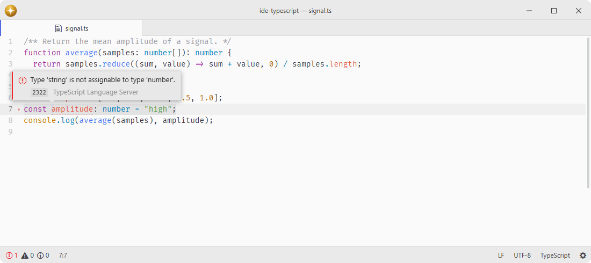

# ide-typescript

TypeScript and JavaScript language-server adapter.

Workspace symbol search uses the standard language-server protocol and covers every TypeScript project already activated in the running server. Opening the workspace symbol picker does not start the server or discover closed projects.

Registers the native TypeScript 7 language server with `ide`, providing completions, pull diagnostics, navigation, formatting, and source actions for TypeScript and JavaScript projects.

## Features

- **Server choice**: ships a pinned native TypeScript 7 compiler, can install newer native compilers, and accepts a custom native executable.
- **Import style**: chooses the quotes, path style, and extension of every import the server inserts, and can exclude modules from auto-import entirely.
- **Inlay hints**: shows inferred parameter names, variable, property and return types, and enum values, each behind its own switch.
- **Code lens**: serves implementation and reference counts for the line a declaration sits on, which the code-lens package renders above it.
- **Source actions**: renames symbols, organizes imports, removes unused imports, and applies server-provided fixes.
- **Call hierarchy**: explores incoming and outgoing calls through the language-server client.
- **Feature switches**: choose which supported capabilities the editor uses, letting another server handle the ones you disable.
- **Project sessions**: one server per project root, started lazily with the first matching editor.
- **Workspace configuration**: answers native server configuration requests with import, hint, locale, type-acquisition, and editor formatting preferences.

## Installation

To install `ide-typescript` search for it in the Install pane of the Lumine settings, or run the command `lumine --install lumine-code/ide-typescript`.

Install `ide` first.

Compiler options belong in the project's `tsconfig.json` or `jsconfig.json`. Server Path now selects a native TypeScript compiler executable; the Node tsserver path, syntax-server process, Node heap limit, and wrapper-specific completion and diagnostic controls have been removed. Reinstall a previously managed TypeScript 6 server from Settings before using it with this adapter.

## Services

- `ide`: consumed to register the TypeScript adapter with the editor's language-server client.

## Contributing

Got ideas to make this package better, found a bug, or want to help add new features? Just drop your thoughts on GitHub. Any feedback is welcome!
